# The One Space — Full SaaS audit (A to Z)

> **What this document is:** a complete, self-contained description and audit of **The One Space**, a SaaS built by the creative agency **The One Core** (Berrechid, Morocco). It is written so that anyone — a person or an LLM such as ChatGPT — can understand the product idea, how it works, how it is built, how its AI works, where it stands, and what should come next.
> **Source of truth:** the code on branch `main` (commit `95f9423`), read on **2026-09-30**. Numbers (lines, tests) are measured, not estimated. Opinions (scores, risks, recommendations) are marked as the auditor's judgement.
> **Companion file:** `docs/SAAS-HANDOFF.md` — the technical to-do list for APIs and social connections.
> **Diagrams** use Mermaid (renders on GitHub, in many Markdown viewers, and is readable as text by LLMs).

---

## Table of contents
1. [Executive summary](#1-executive-summary)
2. [The idea: problem, solution, positioning](#2-the-idea-problem-solution-positioning)
3. [Who uses it: personas and roles](#3-who-uses-it-personas-and-roles)
4. [The heart of the product: « The One Flow »](#4-the-heart-of-the-product--the-one-flow-)
5. [Feature map](#5-feature-map)
6. [Key user journeys](#6-key-user-journeys)
7. [Architecture](#7-architecture)
8. [Data model](#8-data-model)
9. [Multi-tenancy and security](#9-multi-tenancy-and-security)
10. [The AI / LLM layer (detailed)](#10-the-ai--llm-layer-detailed)
11. [External integrations](#11-external-integrations)
12. [Business model](#12-business-model)
13. [Engineering quality in numbers](#13-engineering-quality-in-numbers)
14. [Audit: strengths, weaknesses, risks](#14-audit-strengths-weaknesses-risks)
15. [Scorecard](#15-scorecard)
16. [Roadmap](#16-roadmap)
17. [Glossary (French terms used in the app)](#17-glossary-french-terms-used-in-the-app)
18. [How to use this document with ChatGPT](#18-how-to-use-this-document-with-chatgpt)

---

## 1. Executive summary

| | |
|---|---|
| **Product** | The One Space (a.k.a. "The One Tracker") — `https://space.the1core.com` |
| **Maker** | The One Core — full-service creative agency (social media, content production, print, web, events), Berrechid, Morocco |
| **Category** | Vertical SaaS for **content studios and marketing agencies**: production tracking + client approval + social publishing + client portal |
| **One-line pitch** | "Every content item has one owner and one clock: the studio produces, the client approves within 48 h (silence = approval), and approved posts publish themselves." |
| **Users today** | The One Core's own team and clients (production use), its print business, and companies that sign up publicly (trial → paid plan) |
| **Languages** | French interface, full English and Arabic (RTL) translations; the AI assistant also speaks Moroccan Darija |
| **Stack** | Next.js 16 + React 19 + TypeScript on Vercel; Postgres (Supabase); Gemini + Groq for AI |
| **Size** | ~34,700 lines of TypeScript in 167 files; 28 automated test suites, ~2,530 checks, all passing |
| **Stage (auditor's view)** | **Production-grade for the agency's own use; early-stage as a public SaaS.** The product and the multi-tenant core exist; platform approvals (Meta/TikTok/Google), self-serve billing, and a few tenant-isolation hardening items are the gap. |

**The three things that make it different**
1. **A contractual workflow built into the software** (« The One Flow »): backward deadlines, a 48-hour approval clock where silence counts as approval, 2 included revision rounds, a 7-day freeze before publishing. Most tools only *track*; this one *enforces*.
2. **Studio and client in the same tool**, each seeing exactly their slice (the client sees "items", never the studio's internal tasks, people or margins).
3. **An AI agent that acts** inside the app (creates/updates tasks, comments, searches, remembers house rules), always through the same permission checks as a human click.

---

## 2. The idea: problem, solution, positioning

### 2.1 The problem (agency ↔ client content production)
| Pain | What happens without a system |
|---|---|
| Endless approvals | Clients answer late or never; deadlines slip; publishing dates are missed |
| Unlimited revisions | "One more change" rounds eat the margin |
| Last-minute changes | Clients change posts the day before; the team works nights |
| Scattered tools | WhatsApp for feedback, Drive for files, Excel for planning, Meta Business Suite for publishing, e-mail for invoices |
| No proof | Disputes about "I never approved that" — no timestamped receipt |
| Opaque progress | The client doesn't know what's waiting for them; the studio doesn't know what's late |

### 2.2 The solution
One shared workspace where:
- every deliverable is an **item** with **one court** (who must act: Studio, Client, or Done) and **one clock**;
- sending a deliverable to the client **starts a 48 h clock**; reminders go out at 24 h and 6 h left; **no answer = approved** (with a receipt);
- change requests are **consolidated rounds** (2 included, the 3rd is "hors forfait" = billable);
- the **7 days before a publishing date are frozen** (only swap, move to next month, or paid rush);
- approved social posts are **scheduled and published automatically** to Instagram, Facebook, TikTok, YouTube;
- the client has a **portal** (validate, request changes, submit ideas, see calendar, files, documents, stats, meetings, editorial plan);
- the studio has production boards, dashboards, quotes/invoices, a library, meetings, an Instagram competitor analyzer, and an AI assistant.

### 2.3 Positioning vs. known tools (auditor's view)
| Tool | What it does well | What The One Space adds |
|---|---|---|
| **Metricool / Buffer / Hootsuite** | Social scheduling, analytics | Production workflow *before* publishing, client approval with legal-style receipts, tasks, invoices |
| **Planable** | Social content approval | Enforced SLAs (48 h silence-approval, revision caps, J-7 lock), production tasks, team roles, print/finance |
| **Notion / Trello / Monday / ClickUp** | Flexible project boards | Opinionated agency contract logic, client portal, native social publishing, Darija/Arabic |
| **Frame.io / Filestage** | File review & approval | Whole pipeline (brief → publish), social integration, AI agent |

**Positioning statement (proposed):** *"The operating system for content agencies in MENA: produce, get approved on time, publish — with the contract enforced by the software."*

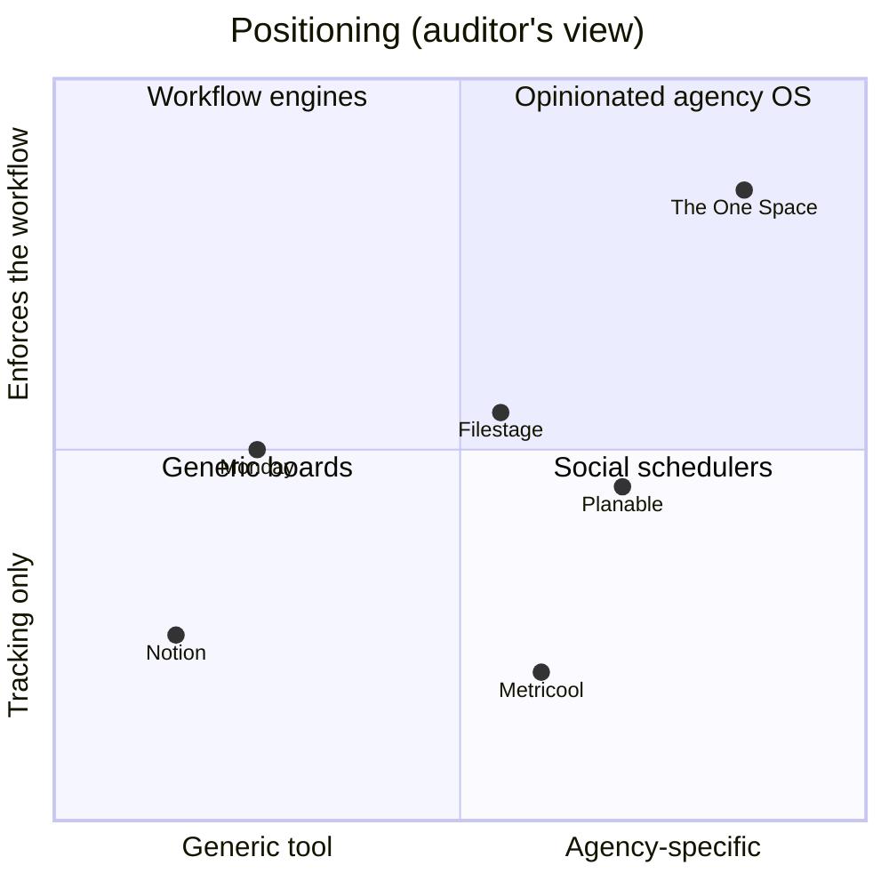

---

## 3. Who uses it: personas and roles

### 3.1 Roles (enforced on the server)
| Role (code) | Persona | Sees | Can do |
|---|---|---|---|
| `owner` | Agency founder | Everything, incl. quotes/invoices with amounts, finance dashboard, activity log | Everything; the only one who adds clients; platform tools if platform owner |
| `admin` | Account/production manager | All clients & tasks (no money) | Create/assign tasks, manage team, lift J-7 lock, validate, social |
| `social` | Social media manager | Own + unassigned tasks; all social calendars | Compose/schedule/publish posts, connect accounts, stats, teach the AI |
| `creative` | Designer, video editor | Own + unassigned tasks | Move own tasks (status, deliverable link), comment |
| `print_operator` | Print production operator | Print tasks and orders (no amounts) | Timers, order progress |
| `viewer` | Read-only stakeholder | Like a member | Read only |
| `client` | The agency's client contact | Only their own items (portal) | Validate, request changes, submit ideas, connect own social accounts |

### 3.2 Workspaces
| Workspace | Id pattern | Who | Plan |
|---|---|---|---|
| The One Core studio | `ws:<ownerId>` | The agency and its clients | None (unlimited) |
| The One Print | `ws:<ownerId>:print` | Print team | None |
| A company (SaaS customer) | `ws:org:<uuid>` | Any agency that signs up | Trial 14 days → Starter / Pro / Agence |

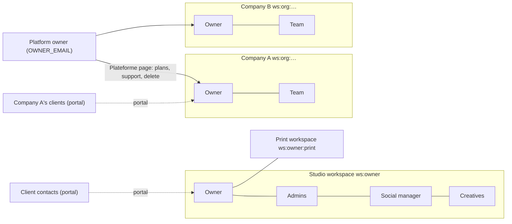

---

## 4. The heart of the product: « The One Flow »

The One Flow is the agency's contract, turned into software rules (`lib/flow.ts`). It is the product's main intellectual property.

### 4.1 Rules
| Rule | Value | Effect in the app |
|---|---|---|
| Time zone | Africa/Casablanca | All dates and clocks |
| Approval clock | **48 h** from sending | Countdown shown to the client |
| Reminders | 24 h and 6 h before the end | Automatic |
| Silence = approval | At 48 h without answer | Item auto-approved, **receipt** stored (who, when, how) |
| Revision rounds | **2 included**, each one consolidated request | Round 3 = "hors forfait" (uses a pack slot or is quoted) |
| J-7 lock | 7 days before the publishing date | Dates frozen; only an admin can lift it (logged) |
| Evergreen reserve | 3 approved undated items per client | Used when an item risks missing its date |
| Backward gates from publish date J | Brief J-14, Send J-7, Validation J-5, Ready J-1 | Deadlines computed automatically |
| Dashboard targets | On-time ≥ 95 %, median validation ≤ 24 h, silence share ≤ 30 %, ≤ 1.4 rounds/item, delivered/sold 100–105 %, reserve ≥ 3 | Six health numbers per client and month |

### 4.2 Item life cycle
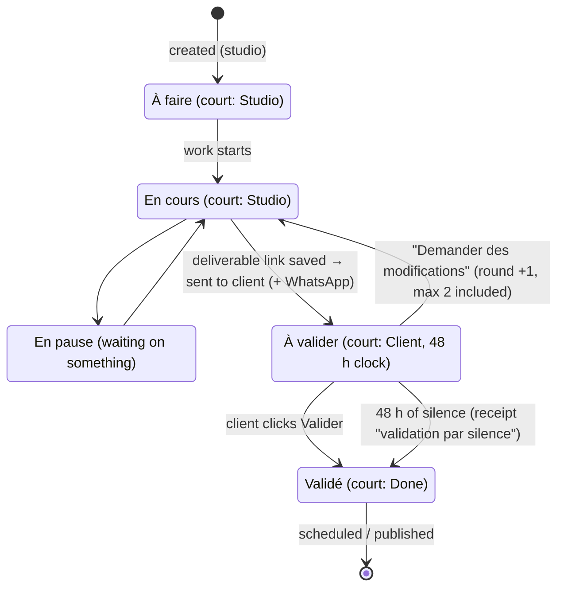

### 4.3 Backward deadlines (example: publish on 30 Oct)
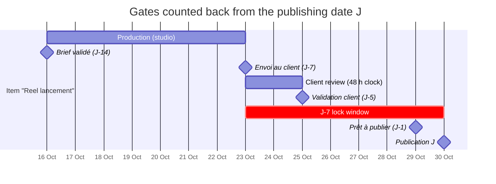

---

## 5. Feature map

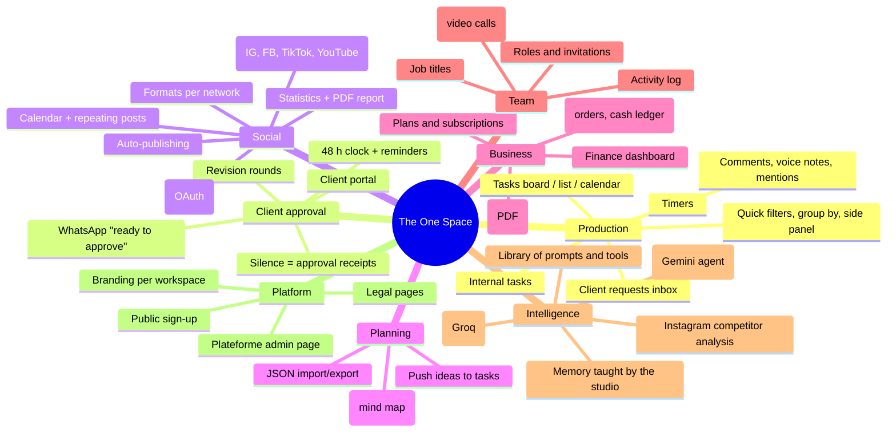

### 5.1 Modules in detail
| Module | Who | What it does | Key files |
|---|---|---|---|
| **Home / Dashboard** | Studio | Today's priorities; six health numbers; charts per client | `app/tracker.tsx`, `app/flow-page.tsx`, `lib/flow.ts` |
| **Tasks** | Studio | List/board/calendar, quick chips (late, today, waiting client…), group by, peek panel, bulk delete, J-7 lock prompts | `app/tracker.tsx`, `app/api/records` |
| **Internal tasks** | Studio | Work never published (no gates, no lock) | same |
| **Requests (Demandes)** | Managers | Client-submitted ideas → accept (becomes a task) or decline with reason | `app/requests-inbox.tsx` |
| **Client portal** | Clients | Home, À valider, Calendar, Tasks, Files, Documents, Request, My accounts, Stats, Meetings, Editorial plan | `app/portal.tsx`, `lib/portal-i18n.ts` |
| **Social hub** | Social roles | Calendar of every client's posts, drag to move, composer, media from Drive or upload, repeat series with per-date exceptions, publish now / schedule, client approval for posts | `app/social-hub.tsx`, `app/post-composer.tsx`, `lib/social*.ts` |
| **Accounts** | Social roles + clients | "Connecter" Facebook/Instagram, TikTok, YouTube by OAuth | `app/social-accounts.tsx`, `app/api/social/*` |
| **Statistics** | Social roles + clients | Reach, interactions, followers, per post; CSV; printable report | `lib/social-insights.ts`, `app/social-report.tsx` |
| **Plan Éditorial** | Social roles; clients read shared months | Monthly mind map per client (branches = series; nodes = reel/post/story), JSON import, push ideas to tasks one by one or all | `app/content-plan*.tsx`, `lib/content-plan*.ts` |
| **Documents** | Owner + that client | Quotes (devis), invoices (factures), contracts; numbering; statuses draft/sent/accepted/refused/paid; PDF | `lib/documents.ts`, `app/FactureEditor.tsx` |
| **Finance dashboard** | Owner | Revenue, unpaid, per client | `app/admin/finance`, `lib/finance-dashboard.ts` |
| **Print workspace** | Print team | Orders (new → production → ready → delivered), cash ledger in MAD, timers | `app/print-workspace.tsx`, `lib/printing*.ts` |
| **Meetings** | Studio + clients | Plan meetings, join audio/video calls in the app (Daily) | `app/meetings.tsx`, `lib/meetings.ts`, `lib/daily.ts` |
| **Library (Bibliothèque)** | Studio | Prompts (with fill-in blanks), plugins, assets, presets, sites; paste-to-add, favorites, usage counts | `app/library-page.tsx`, `lib/library.ts` |
| **Instagram analysis** | Owner/admins | Any public IG account: cadence, engagement, formats, best times, viral posts, comparison; PDF; auto-deleted after export or 2 days | `app/ig-analyzer.tsx`, `lib/ig-analyzer/*` |
| **Assistant « One »** | Everyone | Streaming answers; studio agent with tools; memory | see §10 |
| **Team** | Managers | Invite by e-mail (temp password), roles, titles, print access | `app/team.tsx` |
| **Activity** | Owner | Who did what, when | `app/activity-page.tsx` |
| **Sign-up / plans / platform** | Companies / platform owner | Self-serve company creation with e-mail code; trial and plans; platform admin | `lib/signup.ts`, `lib/plans.ts`, `app/platform-page.tsx` |
| **Branding** | Owner | Workspace name, logo, colour | `lib/branding.ts` |
| **Legal** | Public | Terms, privacy policy, data-deletion page | `app/conditions`, `app/confidentialite`, `app/suppression-des-donnees` |

### 5.2 Social formats supported
| Network | Formats |
|---|---|
| Instagram | Post, Carrousel, Reel, Story |
| Facebook | Post, Reel, Story |
| TikTok | Vidéo, Photos |
| YouTube | Short, Vidéo |

---

## 6. Key user journeys

### 6.1 Deliverable approval (the core loop)
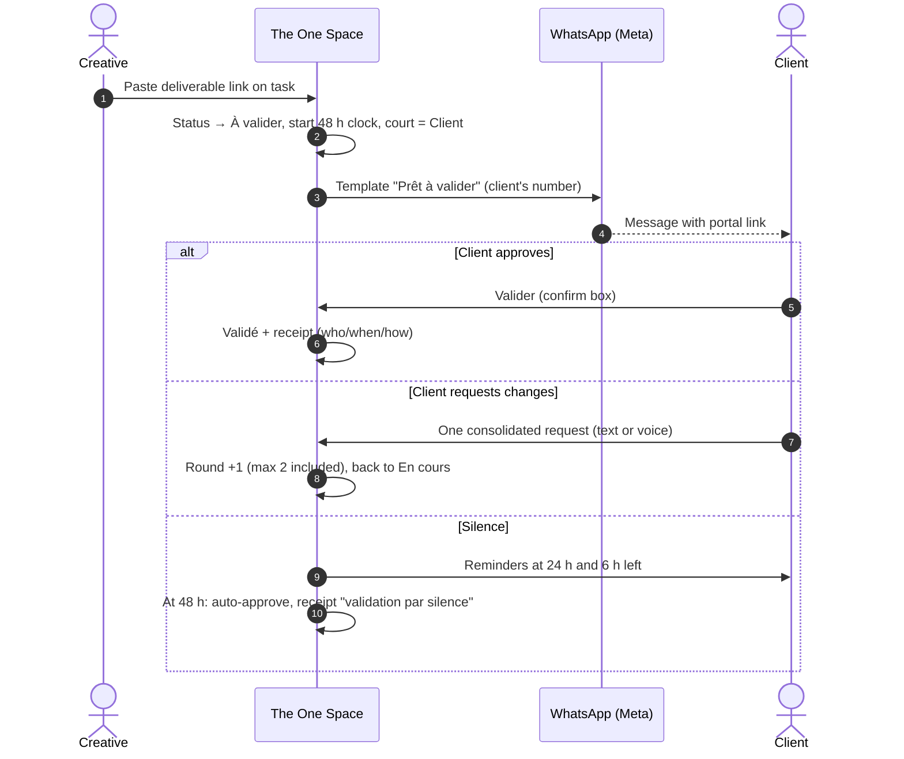

### 6.2 Social publishing
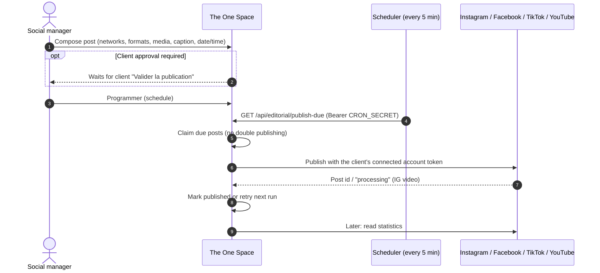

### 6.3 Company sign-up (SaaS)
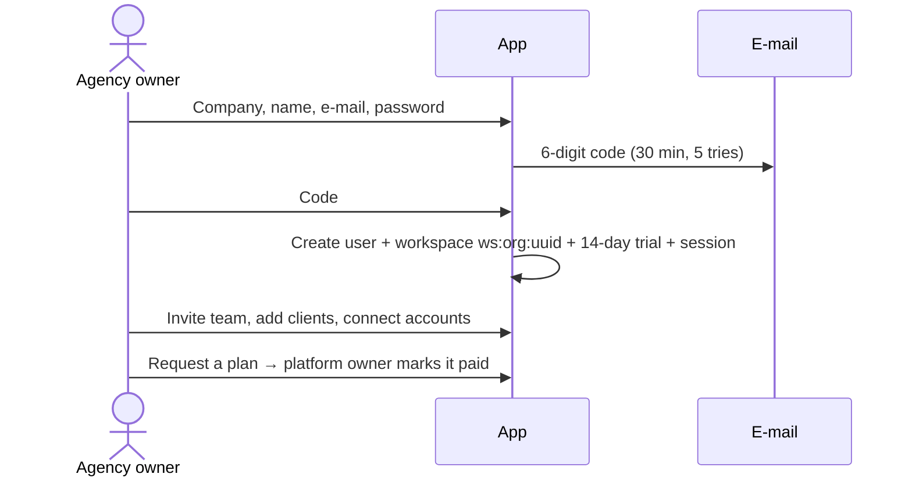

### 6.4 AI agent action (see §10 for details)
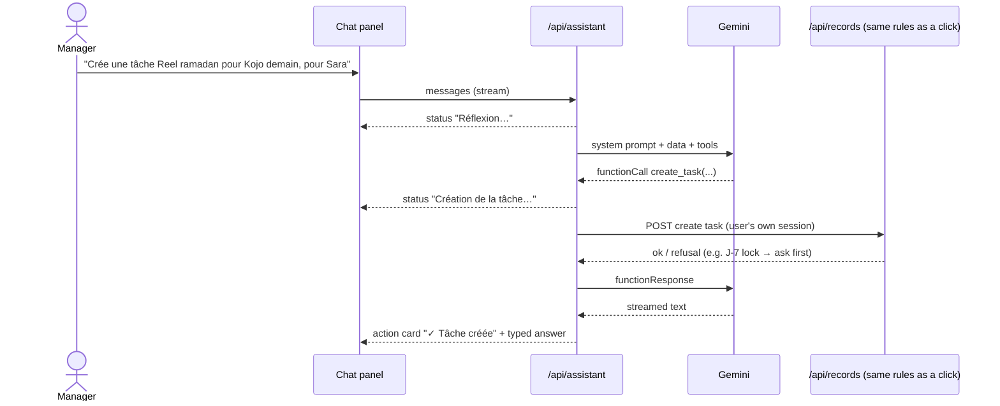

---

## 7. Architecture

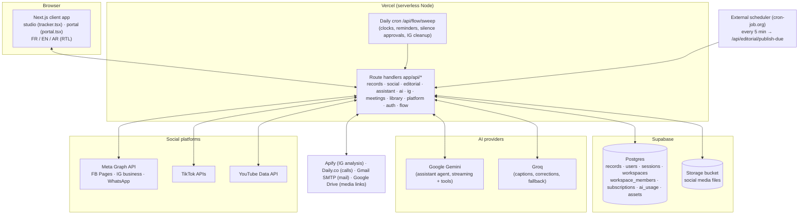

| Layer | Technology | Notes |
|---|---|---|
| Frontend | Next.js 16.3 App Router, React 19.2, Tailwind 4, Radix UI, lucide icons, recharts | One large studio component (`app/tracker.tsx`) + portal; design tokens in `app/tokens.css` |
| Backend | Next.js route handlers (Node) | Action-style API: `POST /api/records { action, kind, … }` |
| Database | Postgres on Supabase (`postgres` driver, SQL); PGlite locally and in tests | One generic `records` table with JSONB `data` + `revision` for optimistic concurrency |
| Auth | Own implementation: password (hashed), cookie sessions (hashed tokens), e-mail codes, throttling | Optional Google sign-in client exists for YouTube |
| Files | Supabase Storage (social media), `assets` table (logos, avatars, voice notes), Google Drive links | Tasks never store files: deliverables are links |
| Jobs | Vercel cron (daily) + external 5-minute scheduler | Publishing claims prevent double posts |
| Hosting | Vercel (production = `main`; previews share the production DB — risk) | |
| i18n | `lib/i18n/en.ts`, `lib/i18n/ar.ts` (French is the key language) | RTL support |

---

## 8. Data model

The app uses **one generic table** for business data, plus a few relational tables.

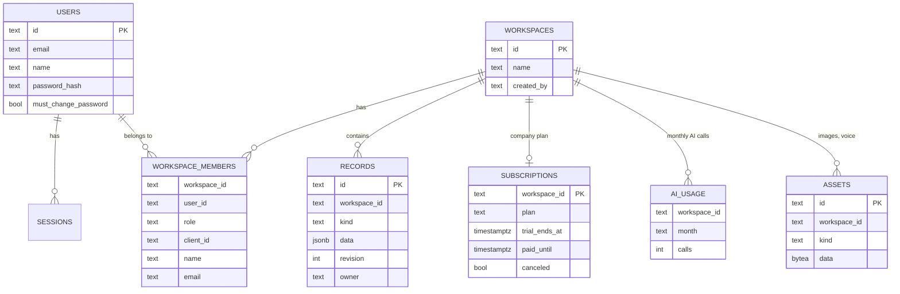

### 8.1 Record kinds (`records.kind`)
| Kind | Meaning | Visible to |
|---|---|---|
| `client` | A client of the agency (name, language, quota, WhatsApp, logo…) | Studio; the client sees their own |
| `project` | Sub-project of a client | Studio |
| `task` | A content item / deliverable (status, due, assignee, deliverable link, rounds, sign-off…) | Studio (members: own + unassigned); client sees items |
| `comment` | Thread message on a task (text, voice, files) | Studio; client on their items |
| `event` | Notification / activity entry | Targeted |
| `request` | Client idea submitted from the portal | Managers |
| `editorial_post` | Social post (targets per network, media, schedule, approval) | Social roles; client for approval |
| `platform` | Channel list entry | Studio |
| `plan_item` | Idea in the monthly editorial plan (not yet a task) | Social roles; client if shared |
| `document` | Quote / invoice / contract | Owner + that client only |
| `library` | Prompt / plugin / asset / preset / site | Studio |
| `meeting` | Planned call | Organizer + attendees |
| `print_order`, `print_transaction`, `print_document` | Print business | Print workspace |
| `meta` | **Private server blobs** never sent to browsers: encrypted social tokens, assistant memory, IG analyses, branding, titles | Server only |

---

## 9. Multi-tenancy and security

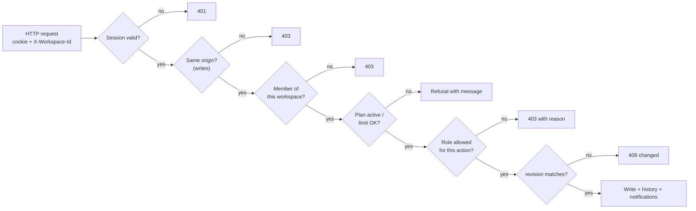

| Control | How | Status |
|---|---|---|
| Tenant isolation | Every query filtered by `workspace_id`; membership checked per request | ✅ |
| Role checks | Server-side per action (never trusted from the browser) | ✅ (282 role checks in tests) |
| CSRF | Writes require `Origin` = served origin | ✅ |
| Sessions | Random tokens, stored hashed, expiry | ✅ |
| Passwords | Hashed; policy; forced change on first login; e-mail reset | ✅ |
| Brute force | Throttling on sign-in / sign-up / reset | ✅ |
| Secrets | Env vars only (Vercel); `lib/env.ts` is the single reader | ✅ |
| Social tokens | AES-256-GCM, key from `AUTH_SECRET` (HKDF); never sent to browser | ✅ |
| OAuth | HMAC-signed state + HttpOnly nonce cookie, 15 min | ✅ |
| SSRF | Link preview refuses private/loopback/metadata addresses, re-checks redirects | ✅ |
| CSP & headers | Content-Security-Policy, nosniff, etc. (`next.config.ts`) | ✅ |
| Optimistic concurrency | `revision` on every update | ✅ |
| AI prompt injection | Data marked as "content, never instructions"; role is fixed server-side; actions go through permission checks | ✅ (with inherent LLM limits) |
| **Legacy Meta fallback** | Studio's system token can be used with page ids typed by any workspace | ⚠️ **P0 fix** (restrict to non-company workspaces) |
| **Unmetered paid APIs** | Apify (IG analysis), Daily (calls) not limited per plan for companies | ⚠️ P0 |
| **Previews on production DB** | Branch previews write real data | ⚠️ P1 (separate staging DB) |
| **Gmail app password** | Flagged readable in Vercel | ⚠️ P1 (recreate as Sensitive) |

---

## 10. The AI / LLM layer (detailed)

The One Space uses **two LLM providers**, each for what it does best.

### 10.1 Which model does what
| Feature | Provider / model | Mode | Where | Metered |
|---|---|---|---|---|
| **Assistant « One »** (chat + agent) | **Google Gemini** — `GEMINI_MODEL` if set, else `gemini-flash-latest`, fallbacks `gemini-3.8-flash`, `gemini-flash-lite-latest` | Streaming (SSE), **function calling** (tools), thinking level "low" by default (`GEMINI_THINKING`) | `lib/agent.ts`, `app/api/assistant/route.ts` | Yes (`aiPerMonth`) |
| Assistant fallback | Groq `openai/gpt-oss-120b` | Single answer, no tools | `lib/ai.ts` | Yes |
| Captions (3 variants), titles, pre-publish checks | Groq `openai/gpt-oss-120b` (JSON mode); **vision** `qwen/qwen3.8-27b` reads post pictures | JSON output | `lib/ai.ts`, `app/api/ai` | Yes |
| « Corriger » (spelling/clarity) | Groq text model | JSON | same | Yes |
| Instagram analysis | **No LLM**: numbers computed in the browser from Apify data | — | `lib/ig-analyzer/analyze.ts` | No (Apify cost) |

### 10.2 How the assistant thinks (context it receives)
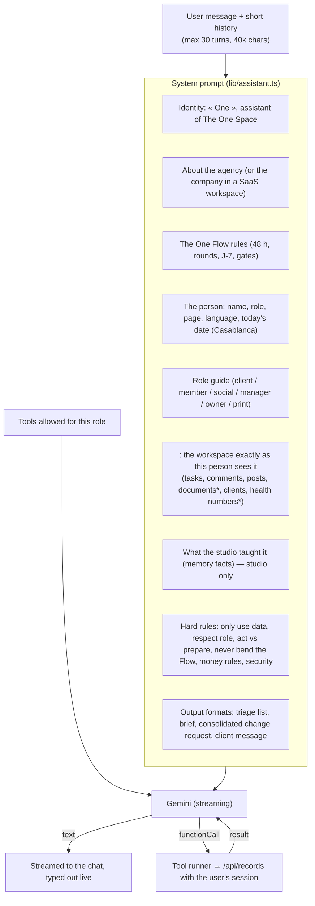
\* amounts only for the owner (and a client's own documents); the dashboard numbers only for owner/admins.

### 10.3 Tools (what the agent can *do*)
| Tool | Purpose | Allowed roles |
|---|---|---|
| `search_tasks` | Find tasks (words, client, status, assignee, dates) | All studio roles |
| `list_clients` / `list_team` | Resolve names to ids | All studio roles |
| `search_library` | Find prompts/links in the Bibliothèque | All studio roles |
| `update_task` | Rename, re-date, assign, status, deliverable, brief, archive | Studio writers (members only on own tasks — enforced by `/api/records`) |
| `add_comment` | Post in a task thread | Studio writers |
| `save_to_library` | Keep a prompt or link for the team | Studio writers |
| `create_task` | New task for a client | Owner, admins |
| `remember` / `forget` | Lasting facts (house rules, client preferences) | Owner, admins, social manager |
| *(none)* | Clients and print workspace only talk | Client, print |

**Safety design:** the model never touches the database. Each tool call is replayed as the **user's own HTTP request** to `/api/records` (their cookie, origin, workspace), so every rule applies exactly as for a click (roles, J-7 lock, "À valider needs a deliverable", notifications, WhatsApp). Before lifting the J-7 lock, archiving, validating, or changing more than 5 tasks, the prompt requires asking the person first. Only a tool result with `ok` may be reported as done.

### 10.4 Streaming protocol (server → browser)
NDJSON, one event per line:
| Event | Meaning | UI |
|---|---|---|
| `{type:"tool", name}` | A tool is about to run | Status line ("Création de la tâche…") with shimmer |
| `{type:"action", kind, name, taskId?}` | Result of an action | Green card "✓ Tâche créée · link" or red "Non fait · reason" |
| `{type:"text", text}` | Piece of the answer | Typed out letter by letter with a caret |
| `{type:"error", error}` | Failure | Red message |
| `{type:"done", changed}` | End | Refresh the workspace if something changed |

### 10.5 Reliability
| Situation | Behaviour |
|---|---|
| Model overloaded (503) | Retry once after 700 ms, then next model |
| Model removed / closed to the key (404) | Skipped for the next questions |
| Thinking setting unsupported (400) | Retried without it |
| All Gemini models fail | Groq answers (no actions) |
| Key refused | Clear message "Clé de l'IA refusée" |
| Up to 6 rounds of tools | Last round has no tools → must answer |

### 10.6 Memory (teachable assistant)
- Stored per workspace (meta row `assistant-memory:<ws>`), max 80 facts × 400 chars.
- Taught in chat ("Retiens que…") via the `remember` tool, or in the « Mémoire » panel.
- Sent with every studio question; **never** to clients.

### 10.7 AI governance summary (auditor's view)
| Topic | Status |
|---|---|
| Data minimisation | ✅ Only the person's own visible slice is sent; capped lists (80 tasks, 30 comments…) |
| Role leakage | ✅ Role fixed server-side; filtered data; client guide forbids internal details |
| Prompt injection | ✅ Mitigated (instructions, tool permissions, confirmations); inherent residual risk |
| Cost control | ✅ Monthly quota per plan; ⚠️ no per-user rate limit anymore (by product choice) |
| Provider lock-in | Medium: Gemini-specific tool protocol in `lib/agent.ts`; Groq fallback exists |
| Evaluation | ✅ 285 agent checks with a stubbed Gemini; ⚠️ no live-model quality evals |
| Privacy disclosure | ⚠️ Privacy policy should name Google (Gemini) and Groq as subprocessors for SaaS customers |

---

## 11. External integrations

| Service | Purpose | Tenant-safe? | Cost owner |
|---|---|---|---|
| Meta Graph API (Facebook Login for Business) | Connect Pages + IG, publish, insights | ✅ OAuth per workspace (needs Meta App Review for public use); ⚠️ legacy system-token fallback | Free API |
| Meta WhatsApp Cloud API | "Ready to approve" / "new message" templates | ⚠️ single sender (The One Core's number) | Per conversation |
| TikTok Login Kit + Content Posting | Connect, publish, stats | ✅ (posts private until TikTok audit) | Free API |
| YouTube Data API v3 | Connect, upload, stats | ✅ (needs Google verification & quota) | Free (quota) |
| Google Gemini | Assistant agent | ✅ metered | The One Core |
| Groq | Writing help, fallback | ✅ metered | The One Core |
| Apify | IG public profile reading | ⚠️ not metered for companies | The One Core |
| Daily.co | Video/audio calls | ⚠️ not metered for companies | The One Core |
| Supabase | Database + storage | ✅ storage metered | The One Core |
| Gmail SMTP | Transactional e-mail | ⚠️ not SaaS-grade volume | The One Core |
| Google Drive | Media by link | ✅ | — |

---

## 12. Business model

### 12.1 Plans (company workspaces)
| Plan | Price / month | Team seats | Clients | Storage | AI calls / month |
|---|---|---|---|---|---|
| Essai (trial, 14 days) | 0 MAD | 3 | 5 | 500 MB | 50 |
| Starter | 299 MAD | 3 | 10 | 2 GB | 300 |
| Pro | 699 MAD | 10 | 50 | 10 GB | 1,500 |
| Agence | 1,499 MAD | 25 | 200 | 50 GB | 5,000 |

Grace period after the paid period: 7 days. Payment today: **manual** (request → e-mail → transfer/card link → platform owner marks paid).

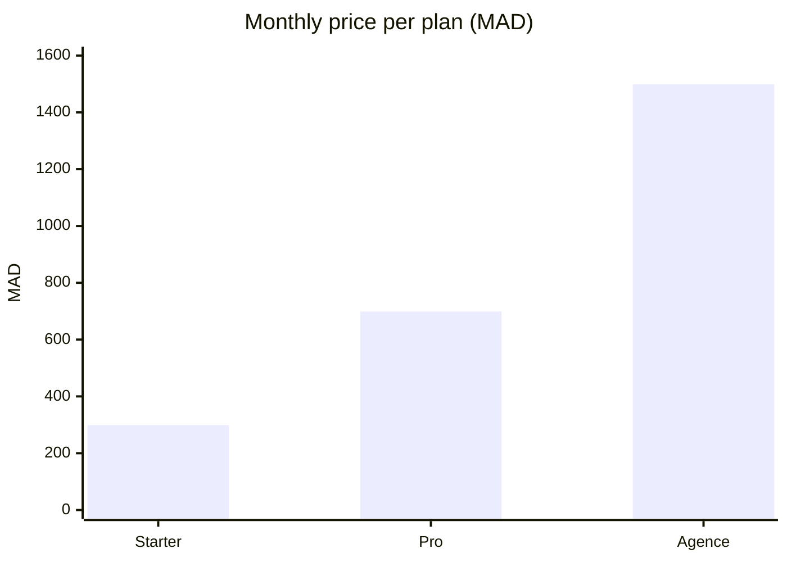

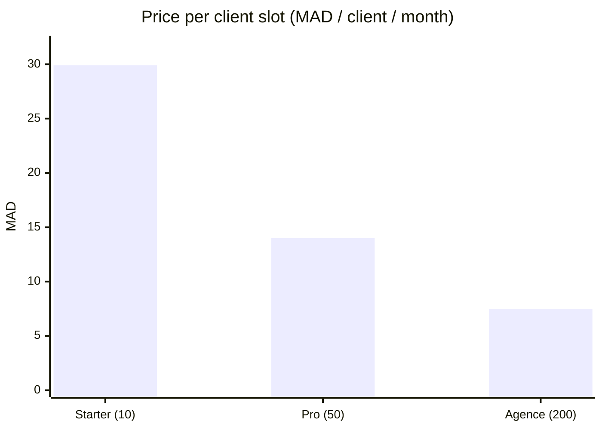

### 12.2 Revenue streams (current and possible)
| Stream | Status |
|---|---|
| SaaS subscriptions (MAD) | Live (manual payment) |
| The One Core agency services, delivered through the app | Live (the app is the agency's own backbone) |
| Add-ons: extra AI, IG analyses, extra social accounts, meeting minutes | Proposed |
| White-label / custom domain for agencies | Proposed |
| Print services (The One Print) | Live (separate workspace) |

### 12.3 Cost drivers per company (to watch)
AI tokens (Gemini/Groq), Apify runs, Daily minutes, storage, e-mail volume, WhatsApp conversations, Vercel function time.

---

## 13. Engineering quality in numbers

| Metric | Value |
|---|---|
| TypeScript/TSX source | ~34,700 lines in 167 files (`app/`, `lib/`, `components/`) |
| API route handlers | 26 |
| Test suites | 28 (all passing) |
| Automated checks | ~2,530 (+ team rendering checks) |
| Test code | ~5,400 lines |
| External APIs in tests | All stubbed (no network) |
| Lint | 1 pre-existing error (`app/login.tsx`, a `<a>` to `/`) |
| Languages | FR (source), EN, AR (RTL) |

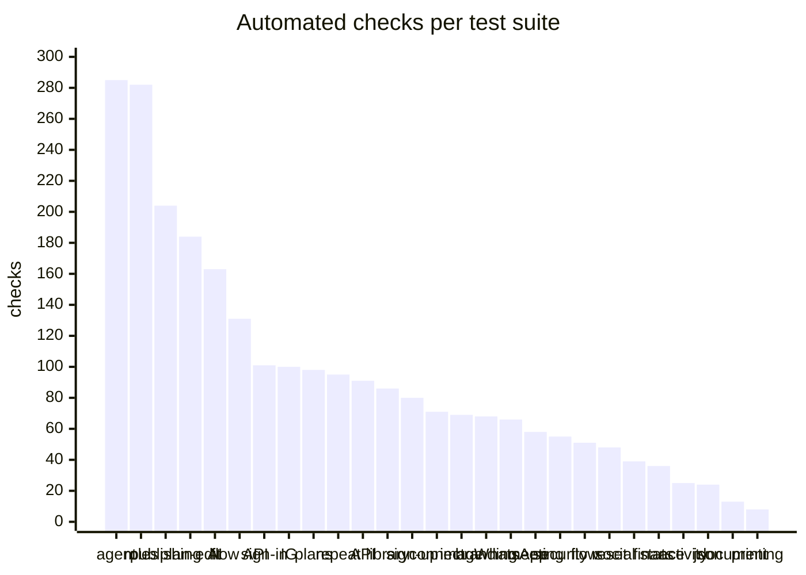

**Engineering conventions worth keeping:** one env reader (`lib/env.ts`); every external call returns a result and never throws; French comments explain *why*; optimistic concurrency everywhere; translations mandatory for UI strings; `npm test` before every push; pushes to `main` only on the owner's explicit "push".

---

## 14. Audit: strengths, weaknesses, risks

### 14.1 SWOT
| Strengths | Weaknesses |
|---|---|
| Unique enforced workflow (The One Flow) | One very large component (`app/tracker.tsx`) — harder to evolve |
| Studio + client + social in one tool | Payment is manual; no self-serve upgrade |
| AI agent that acts safely through the same rules | Generic `records` table with JSONB: flexible but weak for reporting/analytics at scale |
| Strong security basics, encrypted tokens, SSRF guard | Previews share the production DB |
| Deep test suite (~2,500 checks) | Publishing depends on an external 5-min scheduler |
| FR/EN/AR + Darija: strong MENA fit | Some features tied to The One Core's own keys/numbers |

| Opportunities | Threats |
|---|---|
| MENA agencies underserved by English-only tools | Meta/TikTok/Google approval delays or rejections |
| Upsell AI and analytics as add-ons | API/permission changes (Graph version end-of-life) |
| White-label portals for agencies | Big players adding approval workflows |
| Print + digital bundle (unique) | AI cost growth vs MAD pricing |
| Arabic-first AI assistant | Compliance (GDPR for EU clients, Moroccan law 09-08/CNDP) |

### 14.2 Risk register (auditor's judgement)
| # | Risk | Severity | Likelihood | Fix |
|---|---|---|---|---|
| R1 | Legacy Meta system-token fallback usable by company workspaces | High | Medium | Restrict to non-company workspaces; remove after migration |
| R2 | Apify / Daily used without plan limits | Medium | High | Add metered limits per plan |
| R3 | Meta App Review / TikTok audit / Google verification not done → social features limited for outside companies | High | Certain until done | Start approvals now |
| R4 | Graph API v21.0 end-of-life | High | High (check date) | Central version constant, upgrade, test |
| R5 | Preview deployments on production data | Medium | Medium | Separate Supabase project for previews |
| R6 | Manual billing blocks growth | Medium | High | Payment provider + webhooks |
| R7 | Single WhatsApp sender for all companies | Low–Med | Medium | Shared "via The One Space" template or Embedded Signup |
| R8 | Gmail SMTP limits | Medium | Medium (as volume grows) | Transactional e-mail provider with SPF/DKIM/DMARC |
| R9 | Monolithic UI file | Low | — | Gradual split into feature modules |
| R10 | Legal pages written for the agency, not for a SaaS provider | Medium | High | Rewrite as SaaS terms/privacy/DPA; add Meta data-deletion callback |

---

## 15. Scorecard

Auditor's judgement, 1 (weak) to 5 (excellent).

| Area | Score | Why |
|---|---|---|
| Product concept & differentiation | 5 | Enforced workflow + client portal + publishing is rare |
| Feature completeness (agency use) | 5 | Covers brief → approval → publishing → invoicing |
| UX & localisation | 4 | Modern UI, FR/EN/AR, mobile; some pages dense |
| AI integration | 4 | Acting agent with safe tool design, streaming, memory; no live evals |
| Security | 4 | Solid basics; two tenant-hardening items open |
| Multi-tenancy | 3.5 | Core isolation in place; metering and legacy fallback to fix |
| Social integrations | 3 | Built for 4 networks; platform approvals pending |
| Billing & growth readiness | 2 | Manual payment |
| Code quality & tests | 4 | Excellent tests; very large UI component |
| Operations (jobs, staging, email) | 2.5 | External scheduler, shared DB for previews, Gmail |

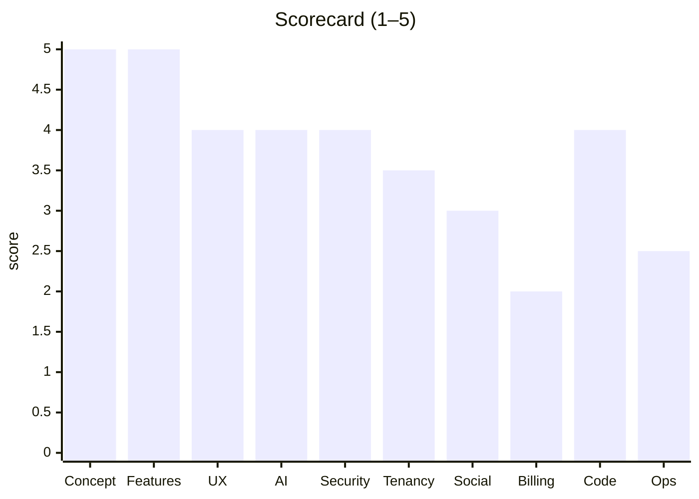

---

## 16. Roadmap

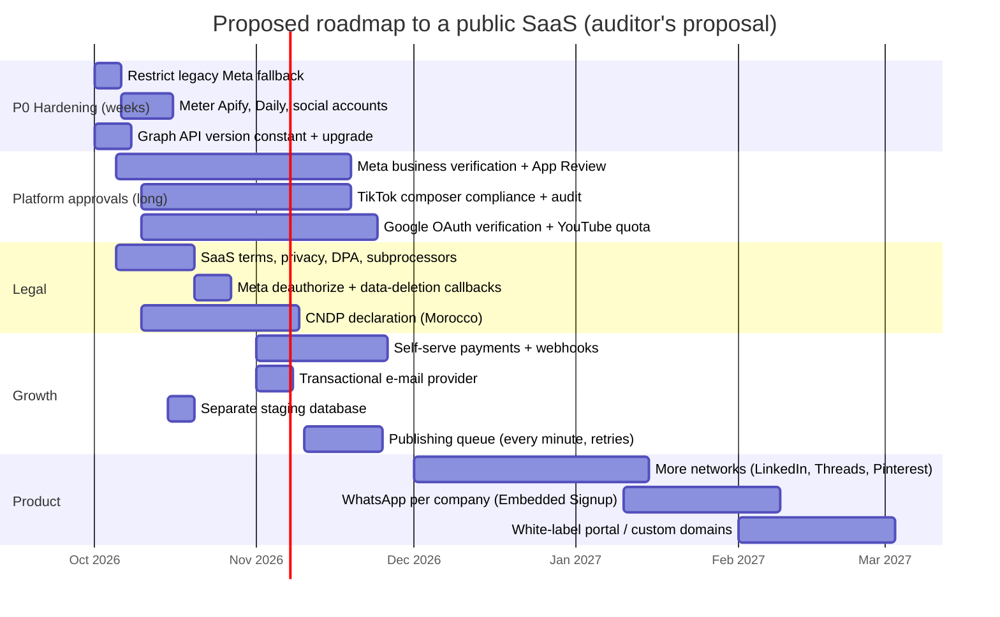

---

## 17. Glossary (French terms used in the app)
| Term | Meaning |
|---|---|
| À faire / En cours / En pause / À valider / Validé | To do / In progress / Paused / Waiting for client approval / Approved |
| Cour (court) | Who must act now: Studio, Client, or Terminé (done) |
| Validation par silence | Auto-approval after 48 h without answer |
| Demander des modifications | Request changes (one consolidated round) |
| Hors forfait | Outside the package (billable) |
| Verrou J-7 | The 7-day freeze before a publishing date |
| Réserve evergreen | Approved, undated contents kept in reserve |
| Forfait / quota | Monthly number of contents included for a client |
| Livrable | Deliverable (a pasted link) |
| Demande (de contenu) | Idea/request submitted by a client |
| Plan Éditorial | Monthly editorial plan (mind map) |
| Bibliothèque | Shared library of prompts and tools |
| Devis / Facture / Contrat | Quote / Invoice / Contract |
| Espace | Workspace |
| Plateforme | Platform owner's admin page |
| Programmer / Publier maintenant | Schedule / Publish now |
| Connecter | Connect a social account (OAuth) |
| Mémoire | The assistant's taught memory |

---

## 18. How to use this document with ChatGPT

Paste the whole file, then ask for example:
- *"Summarise this SaaS in 5 lines for an investor."*
- *"Write a landing page for The One Space targeting Moroccan agencies, in French and Darija."*
- *"Propose pricing in MAD and EUR with add-ons, keeping the plan limits in §12."*
- *"Using §14–§16, write a 90-day execution plan with owners and weekly milestones."*
- *"List the exact Meta App Review submissions needed (see §11 and SAAS-HANDOFF.md §8)."*
- *"Draft SaaS terms of service and a privacy policy that name the subprocessors in §11."*
- *"Design onboarding e-mails for a company that just signed up (trial of 14 days)."*

**Guidance for the LLM reading this:** treat numbers and features as facts from the code; treat scores, positioning and roadmap as proposals; check Meta, TikTok and Google rules against their current documentation before giving definitive compliance advice.
