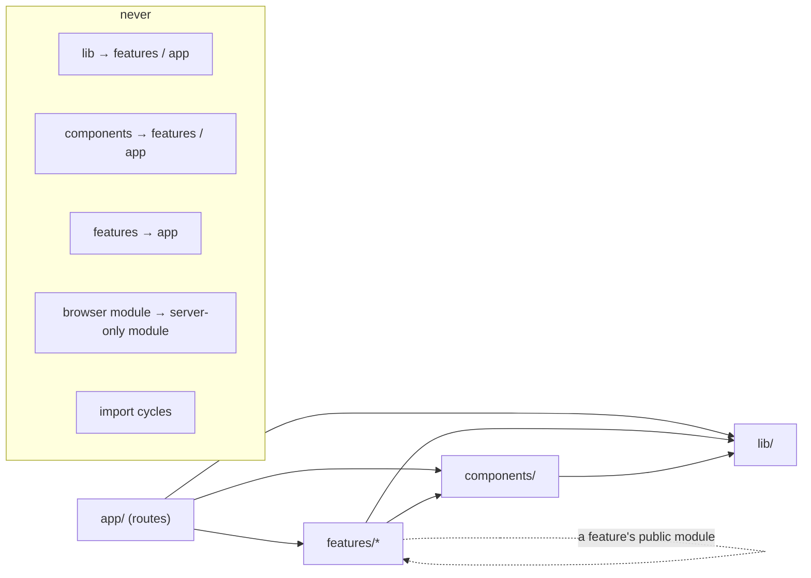
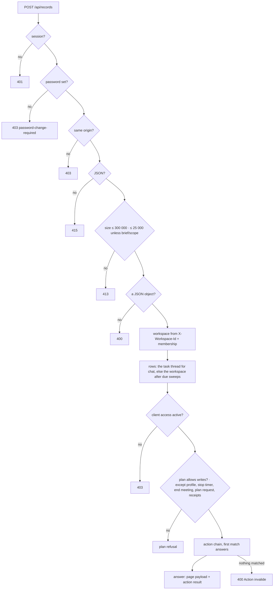
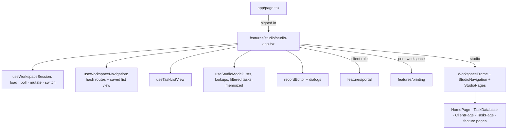

# Architecture

The One Space is one Next.js 16 app, built with the App Router and deployed on Vercel. It serves the studio, its client portal and the print workspace. All of their data lives in one workspace-scoped `records` table (JSONB `data`, a `kind` per row). This document covers where the code lives, which way dependencies point, how a request and a screen are put together, and how to add to the app without breaking those rules.

[refactoring-plan.md](refactoring-plan.md) records how the code reached this shape, with the before and after measurements.

## Layout

```
app/                     Next.js routes only: pages, layouts, error pages, route handlers (app/api/**)
  styles.css             the one global stylesheet entry, in a fixed cascade order
  api/records/route.ts   segment config + GET/POST, delegating to features/records/server
features/<feature>/      one folder per product area: its screens, hooks, model, server code, styles
components/              shared UI with no feature knowledge (components/ui: vendored shadcn primitives)
lib/                     shared infrastructure and pure domain rules (database, auth, time, flow, i18n…)
styles/                  global foundation stylesheets (tokens, theme, design system)
tests/                   one Node script per suite; each bundles its entry points with esbuild
scripts/                 checks run by pnpm test (theme contrast, architecture) and benchmarks (bench/)
```

The features:

| Feature | What it holds |
|---|---|
| `studio` | The signed-in app (`studio-app.tsx`): session, navigation, the workspace model, the record editor, dialogs, the page switch |
| `workspace` | Session lifecycle (`use-workspace-session.ts`), hash navigation, the frame and sidebar, brand, settings, screen-prop types |
| `records` | `/api/records` on the server: pipeline, typed action context, the action chain (`server/`) |
| `tasks` | Task model (pure), list view state, the task database (table, board, calendar, side panel), task page, chat, controls |
| `clients` | Clients list, client page, brief board, images, client mark |
| `dashboard` | Home page, studio metrics and charts, period picker |
| `portal` | The client portal: shell, `use-portal.tsx`, one module per screen |
| `printing` | The print workspace: shell, `use-print-workspace.tsx`, dashboard, invoices, ledger, form, CSV model |
| `documents`, `drive`, `social`, `content-plan`, `meetings`, `library`, `flow`, `activity`, `team`, `plans`, `platform`, `requests`, `assistant`, `ig-analyzer`, `auth`, `landing`, `legal` | One product area each |

## Dependency direction



`scripts/check-architecture.mjs` runs first in `pnpm test` and fails on any of the forbidden edges. It derives "server-only" from a module's imports instead of a hand-kept list. A module is server-only when it touches the database, `@/lib/env`, `@/lib/auth`, `next/headers`, Node built-ins or a server driver, when it lives under a `server/` folder or `app/api`, or when it imports such a module. A browser module (`'use client'`) must never reach one. Type-only imports are ignored, since they vanish at build time.

## /api/records

`app/api/records/route.ts` keeps only the segment config and delegates to `features/records/server/pipeline.ts`.



The action chain (`features/records/server/actions/index.ts`) is an ordered list of `ActionStep`s. A step selects requests by `actions` and an optional `when`. It answers with a `Response`, or passes the request on with `null`, which only the print workspace gate does. The order is part of the contract, and `tests/records-pipeline.mjs` pins it:

- `request-plan` answers before the print gate, which refuses whatever the print workspace does not share.
- The kind-specific deletes (library, platform, document) come before the generic delete.
- `library-favorite` and `library-used` from a non-studio role match no step, so the answer is « Action invalide ».
- The generic client, sub-project and task save comes last.

Every step receives an `ActionContext` (`server/context.ts`):

- `req`, `body`, `user`, `workspace`, `db`, `now`, `today`.
- The rows read at the start.
- `result()`, which answers with the fresh page payload.
- `findTask()` (role-aware), `saveTask()` (optimistic, at the read revision) and `insert()`.

Shared SQL shapes live in `server/store.ts`: the optimistic update and delete, the meta upsert, the 60-second WhatsApp lease and the comment-asset cascade.

`GET` answers with the page payload behind a weak ETag; an unchanged poll gets a 304. `threadTaskId` returns one task's messages and `chatTaskId` the people who can be mentioned. Every answer carries `Cache-Control: no-store` and `X-Server-Time`.

Workspace isolation: every query is scoped by the workspace id resolved from the membership (`workspace-access.ts`). The other routes check membership through `lib/membership.ts`.

## The studio on the client



**Session.** `useWorkspaceSession` owns the workspace lifecycle:

- `WorkspaceLoader`, with one active read and cancellation.
- A sequence guard, so a stale answer is never applied.
- A pending-load counter, so a poll never supersedes the sign-in or a switch.
- ETag polling every 5 s while the tab is visible and not switching, plus alert toasts.
- The compact chat merge (a message answered alone).
- The requested-workspace guard on saves, so a switch is never undone by a late answer.
- The tab's workspace in `sessionStorage` (`the-one.workspace`).

**Screens.** Screens receive four explicit prop groups (`features/workspace/screen-props.ts`):

- `data`: records, clients, tasks, members, user, workspace, today, busy.
- `roles`: owner, manager, member, writable, social.
- `lookups`: names, avatars, dates, due labels, archive state.
- `actions`: navigate, open the editor, update, act, mutate, report.

The derived data is memoized on what it depends on, and name lookups go through maps. A render that changes no records reuses all of it.

**Hydration.** The first render matches the server. Per-browser preferences (sidebar width, navigation layout, folded groups, language, theme) are read after mount, or inside components that mount only once the workspace has loaded.

## Styles and translations

`app/layout.tsx` imports only `app/styles.css`. It imports, in cascade order, the foundation in `styles/` and the sheets one feature owns, next to that feature. `tests/design-system.mjs` asserts the order and the single palette. `scripts/check-theme.mjs` checks 199 contrast pairs and scans every stylesheet, source and compiled.

French is the source language. `t("…")` takes the French text as its key. The translations are:

- `lib/i18n/catalog/<area>.ts`: one catalog per area, each entry `[English, Arabic]`.
- `printing.ts`, `pipeline.ts` and `drive.ts`, which take precedence for the keys they share.

`tests/i18n.mjs` checks that:

- every key is in exactly one catalog;
- English and Arabic cover the same keys;
- no translation is empty;
- placeholders survive.

The client portal keeps its structured copy in `lib/portal-i18n.ts`.

## Tests

Each `tests/*.mjs` bundles real entry points with esbuild and runs them on a fresh in-memory PGlite (`tests/helpers/pg.mjs`). The `testRuntimePlugin` replaces these imports by their exact specifier:

- `@/lib/database`
- `@/lib/env`
- `@/lib/auth`
- `next/headers`
- `next/server` (`after()` callbacks are collected in `globalThis.testAfter`)

Server code must therefore import those modules through those exact specifiers, never by a relative path. External providers (Meta, WhatsApp, Gmail, Drive, Apify, Daily, AI) are mocked in the suites that reach them.

## Adding to the app

**A feature.** Create `features/<name>/` with its screen (`<name>-page.tsx`), any hook (`use-<name>.ts`), pure rules (`model.ts`, unit tested) and server code (`server/`, never imported by a browser module). Render the page from `features/studio/studio-pages.tsx` and add its navigation entry in `studio-navigation.tsx`. Give it the screen-prop groups it needs (`Pick<ScreenProps, …>`) rather than the whole context. Put its strings in `lib/i18n/catalog/<name>.ts` with all three languages, and its stylesheet next to it, imported from `app/styles.css` at the right place in the cascade.

**A records action.** Write an `ActionStep` in the matching `features/records/server/actions/<domain>.ts`:

```ts
export const escalateTask: ActionStep = {
  actions: ['escalate-task'],
  async run({ body, workspace, findTask, saveTask, result }) {
    if (!isManager(workspace.role)) return response({ error: 'Seuls le propriétaire et les administrateurs…' }, 403);
    const task = findTask(body.taskId);
    if (!task) return response({ error: 'Tâche introuvable.' }, 404);
    if (!(await saveTask(task, { ...task, priority: 'Urgente' }))) return response({ error: 'Cette tâche a changé. Actualisez avant de réessayer.' }, 409);
    return result({ id: task.id });
  },
};
```

Then add it to `actionChain` in `actions/index.ts`, placed where it cannot shadow a step that answers the same action. Check permissions first, read only the rows the context gives you, and write at the revision you read (`saveTask`, `updateAtRevision`). Add the case to a suite (see below).

**A shared component.** Put it in `components/` only if it knows nothing about a feature. It may import from `lib/` and `components/` only; the architecture check enforces this. Otherwise it belongs to its feature, and other features import it from there.

**A test.** Copy the head of an existing suite, such as `tests/records-pipeline.mjs` for an API or `tests/task-model.mjs` for pure rules. Bundle the entry point with `testRuntimePlugin({ auth: false })` for server code, set `globalThis.testDb`, `testEnv` and `testUser`, and call the exported handlers with `Request` objects. Add the file to `pnpm test` in `package.json`. Keep each suite's output file under `.sites-runtime/` unique, because the suites may run in parallel.

**Moving a file.** Use `git mv`, update every importer, and update any test or script that names its path; `rg 'old/path'` finds them. If the dev server then reports a module it cannot resolve, stop it and delete `.next/dev`. Turbopack's development cache can keep the old paths.

## Performance notes

- The studio derives lists and lookups once per records change (`useStudioModel`). Archive state comes from a set, names from maps, and comment counts from one pass. On 5 000 tasks, the board's derivations take 4.9 ms instead of 221.6 ms (`node scripts/bench/task-list.mjs`).
- Screens that are not on every visit are loaded on demand: the portal, the print workspace, charts, the Social hub, the flow and activity pages, the library, the annex, time records, the client brief and Drive.
- `node scripts/bench/bundle.mjs`, run after `pnpm build`, prints the client JavaScript each route loads.
- The translation catalogs store each French key once: most pages are about 23 KiB lighter gzipped, and the studio 17.5 KiB.
